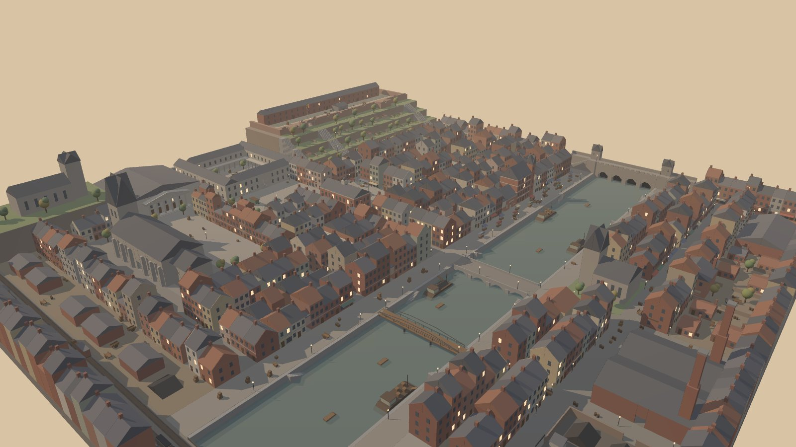
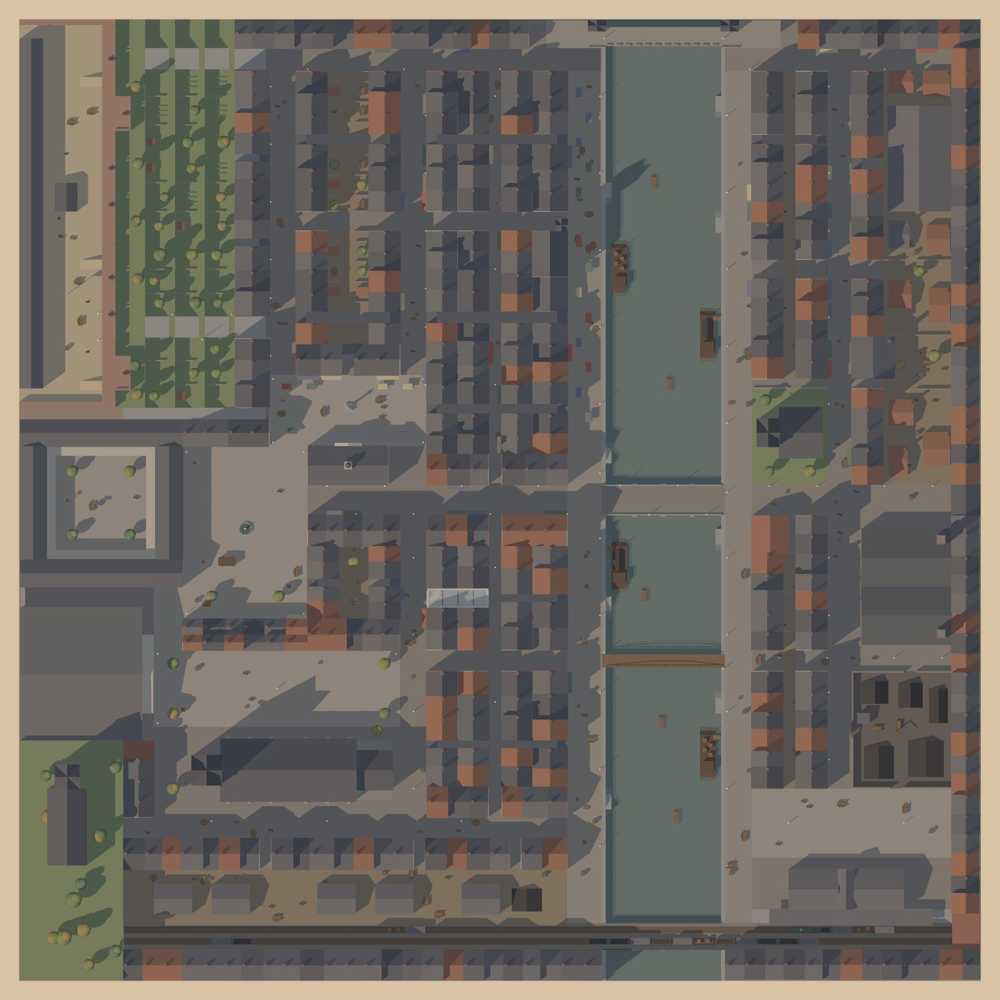
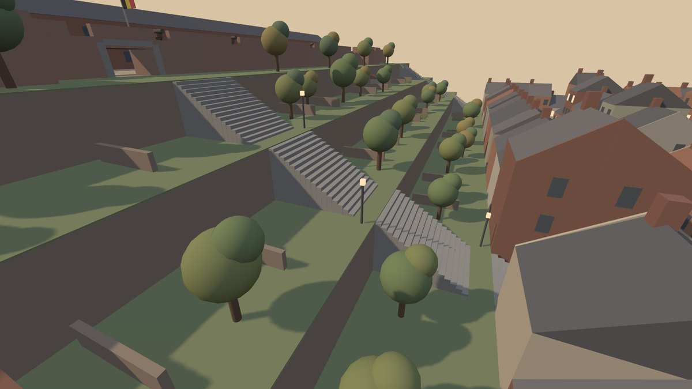
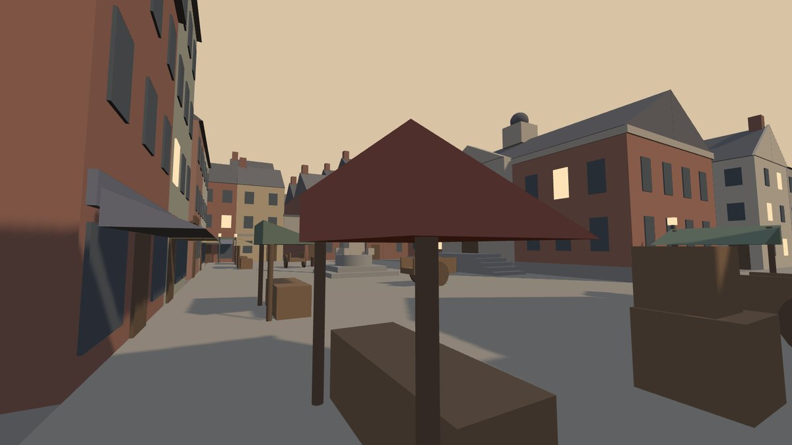
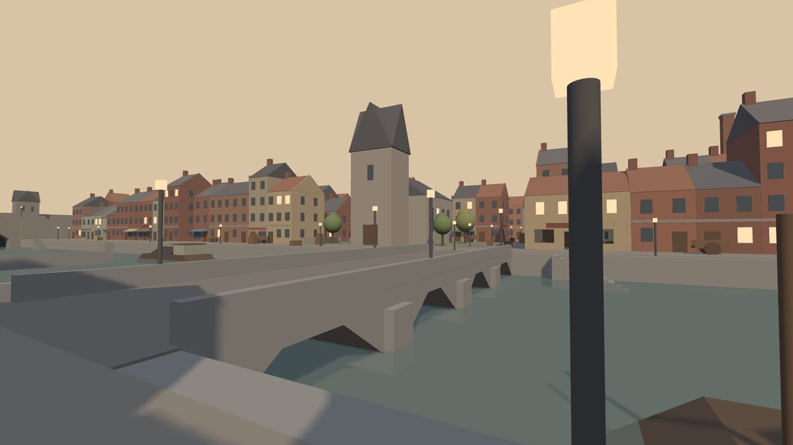
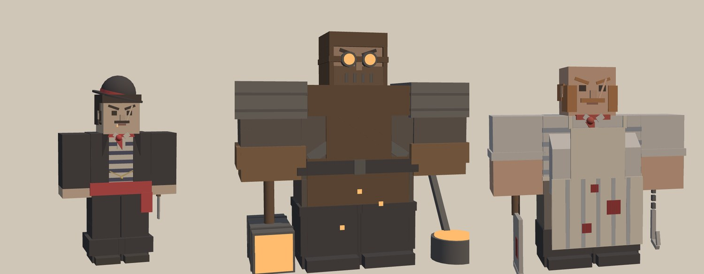
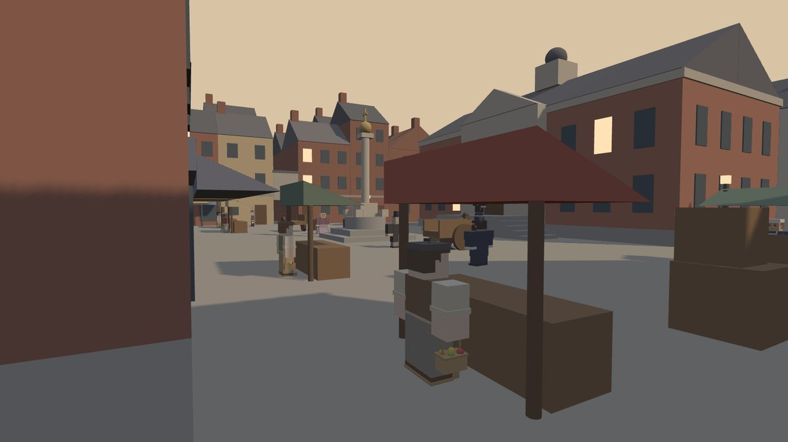
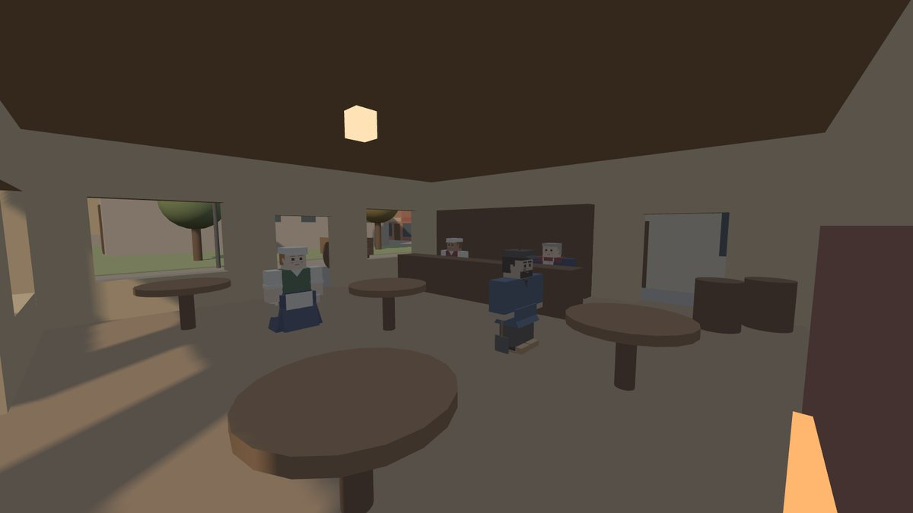
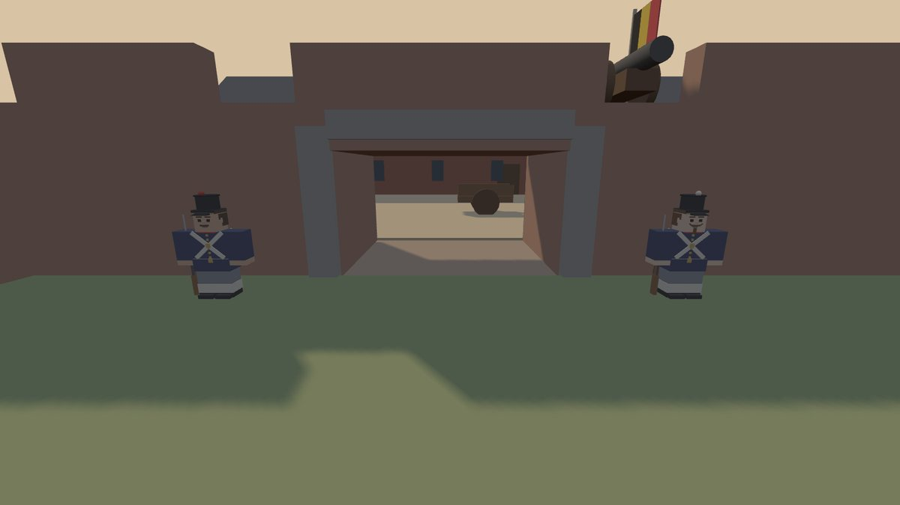
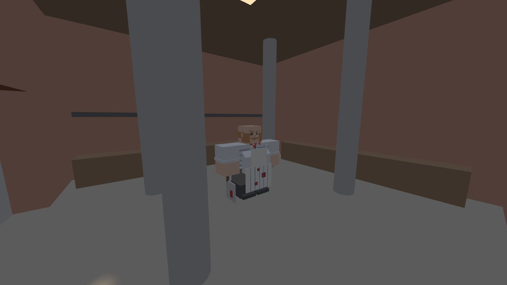

# Liège, 1800s — Roblox map

A 1000 × 1000 stud map of 19th-century Liège, the Belgian gunmaking city where L. Dolne built the
"Apache" knuckleduster revolver, and 63 period NPC models to fill it (townsfolk, workers, police,
the Apache gang, named characters and three bosses). No weapons and no gameplay scripts: the map
lights itself, everything else is models and data.



| | |
|---|---|
|  |  |
|  |  |

These pictures come from a stand-in renderer (`tools/preview`), not from Roblox Studio, so
materials, lighting, fog and the text on signs will look different in Studio.

## Files

| File | Use |
|---|---|
| `build/Liege1800s.rbxm` | The map as one model. Drag it into your existing place. |
| `build/Liege1800s_Preview.rbxl` | A standalone place with the lighting applied and 98 NPCs standing at their markers. |
| `build/LiegeNPCs_R15.rbxm`, `build/LiegeNPCs_R6.rbxm` | The 63 NPC models (same characters, two rig types) and the `NPCCatalog` module. |
| `docs/NPC_SETUP.md` | NPC setup, what each model contains, and the to-do list for scripting them on PC. |
| `src/LiegeMap.luau`, `src/LiegeNPCs.luau`, `src/LiegeNPCPlacements.luau` | The generators. |

## Adding it to your game

1. Drag `build/Liege1800s.rbxm` into Studio and parent the `Liege1800s` model to `Workspace`.
   Don't move it if you can avoid it: it is centred on the origin, street level is `y = 0`.
2. Lighting needs no setup: the map carries its own (see *Lighting and ambience* below) and
   applies it when the game runs. To see it in Studio's edit mode too, paste into the command bar:

   ```lua
   require(workspace.Liege1800s.Ambience.AmbienceCore).preview("Dusk")
   ```
3. Spawns: `SpawnMarkers` holds 24 invisible, non-colliding parts (attribute `LiegeSpawn = true`)
   spread over both banks, the hillside and the citadel. Read their positions from your own spawn
   code, or delete the folder.
4. NPCs: put `LiegeNPCs_R15.rbxm` (or `_R6`) in `ServerStorage` and read
   [docs/NPC_SETUP.md](docs/NPC_SETUP.md). Where each character belongs is in the map's
   `NPCMarkers` folder.

## Lighting and ambience

The `Ambience` folder inside the model holds three scripts that light the map by themselves.
They have been run only in a mocked environment (`tools/test_ambience.luau`), not in Roblox, so
expect to tune the numbers once you see them in Studio.

**Four moods**, chosen with the `Mood` attribute on the `Ambience` folder:

| Mood | Look |
|---|---|
| `Dusk` (default) | Low amber sun through coal haze, gas lamps just lit. |
| `Night` | Blue fog; streets lit only by lamps, windows and forges. |
| `Dawn` | Cold grey river mist, lamps still burning. |
| `Overcast` | Flat grey working day; lamps and windows dark. |

**Attributes on `Ambience`** (edit them in the Properties panel, or set them from your own scripts
while the game runs; changes are picked up within a second):

| Attribute | Default | Meaning |
|---|---|---|
| `Mood` | `Dusk` | Which mood to hold. |
| `CycleMinutes` | `0` | `0` holds the mood. Above zero runs a full day/night cycle of that many minutes, blending through all four moods; the lamps and windows light at dusk and go out after dawn. |
| `ManageLighting` | `true` | `false` makes the scripts leave `Lighting` completely alone. |
| `InteriorGrading` | `true` | Colour shift when the camera is inside a building. |
| `FireFlicker` | `true` | Flicker on forge, furnace and hearth lights. |

**How it fits into an existing game**
- It reuses your `Atmosphere` and `Clouds` if you have them and adds its own post effects named
  `Liege…` next to yours, so your own effects are not deleted. Yours and the map's will stack; if
  the result is too strong, disable one side.
- It remembers every `Lighting` value it changes and puts them back when the map leaves
  `Workspace`, so it should work with a round-based map loader. The restore on `:Destroy()` is the
  part most worth checking in Studio.
- `Lighting.Technology` cannot be set by a script. The moods are tuned for the default (Future).

**What else is in the map for atmosphere**
- Seven interior zones (`Ambience.InteriorZones`): the forge is warm, the cathedral cold, the
  proof house smoky. Each zone part carries its own `Tint`, `Brightness`, `Contrast` and
  `Saturation` attributes.
- Chimney smoke on the foundry stacks, workshops, tavern and locomotive, and flames with
  flickering light in the forge, both furnaces and the tavern hearth. These use Roblox's built-in
  `Smoke` and `Fire` objects, so there are no asset ids to break.

To restyle a mood, edit the numbers in the `presets` table at the top of
`Ambience.AmbienceCore`.

## NPCs



| | |
|---|---|
|  |  |
|  |  |

- **63 models, 38 character types**, built from plain parts in the same style as the map:
  - 3 bosses: the Butcher of the Batte, the Foundry Master and the Apache King.
  - 7 named characters, Louis Dolne among them.
  - The Apache gang.
  - 24 kinds of townsfolk, workers, soldiers and police.
- **R15 and R6 versions** of every character, with standard joint and attachment names, so stock
  animations, accessories and Tools work. No animations are included.
- **Placed on the map**: 95 spawn markers, 7 patrol routes path-found around the street clutter,
  and 3 boss arenas with doorway barriers. All of them are checked against the map's collision
  geometry.

Setup, the contents of each model, and the scripting to-do list are in
[docs/NPC_SETUP.md](docs/NPC_SETUP.md).

## Layout

North is `-Z`, east is `+X`. The Meuse runs north–south through the middle.

**West bank (old town)**
- Place du Marché with the Perron and the Hôtel de Ville; Place Saint-Lambert beside it.
- Palais des Princes-Évêques: arcaded courtyard with two entrances.
- En Hors-Château and Féronstrée, with back yards and alleys between them.
- Montagne de Bueren and two other stairways climbing terraced gardens to the Citadelle.
- Quai de la Batte market, Maison Curtius, Halle aux Viandes (enterable).
- Passage Lemonnier (covered arcade), Cathédrale Saint-Paul (enterable nave), Théâtre Royal.
- Goods yard and railway along the south edge.

**East bank (Outremeuse and Longdoz)**
- Atelier L. Dolne, armurier (enterable shop and forge).
- Banc d'Épreuves, the proof house (enterable firing gallery).
- Estaminet on the quay (enterable), Église Saint-Pholien.
- Fonderie Royale de Canons (enterable hall), coal yard, Gare de Longdoz with a standing train.

**River crossings**: a wall-walk over the north water gate, Pont des Arches, the Passerelle
footbridge, and the railway bridge. The river itself is waist-deep and wadeable, with eight quay
stairs and four barges to climb out on.

## How it is laid out for play

The Apache is a contact-range weapon, so the map is mostly short sight lines: lanes 14–28 studs
wide, alley mouths under archways, walled back yards, and seven interiors. The squares, quays and
bridges are the exposed ground between them. The hillside adds 64 studs of height with three
routes up, and you can drop down the terraces quickly.

## Optimisation

- 9,336 parts in total: 8,148 `Part` and 1,188 `WedgePart`. No unions, meshes or textures.
- Everything is anchored and has `CanTouch = false`.
- About two thirds of the parts are decoration (windows, doors, signs, chimneys): those also have
  `CanCollide`, `CanQuery` and `CastShadow` off, so they cost nothing in physics or raycasts.
- Each house row and landmark is its own `Model` with `LevelOfDetail = StreamingMesh`, so it
  streams well if you turn on `StreamingEnabled`.
- Stairs are visual steps (non-colliding) over one invisible wedge named `StairRamp`. Don't delete
  the ramps: they are what players walk on.
- 126 `PointLight`s, all with shadows off, and 7 smoke emitters. If that is too many for low-end phones, regenerate with
  `lampLights = false`, or delete the lights inside the `GasLamps` model.
- `MapLimits` holds four invisible walls at the edge of the footprint.
- `NPCMarkers` adds 184 invisible, non-interacting marker parts (spawns, waypoints, arena volumes).

## Historical accuracy

The landmarks, street names and their relative positions follow the real city, but this is a
compressed, stylised town, not a survey: roughly 3 km of Liège is squeezed into 1000 studs.
Known liberties:

- The snapshot is around 1870–1880. The Bueren stairs and the Passerelle date from 1880, slightly
  after the first Apache revolvers.
- The cannon foundry and the proof house really stood on the west bank; they are in Outremeuse
  here to give the east bank its own destinations.
- The north water gate is invented, to close the river at the map edge.
- The location of Dolne's workshop is not documented; its placement is a guess.

## Regenerating

The map is deterministic for a given seed. To change it, edit `src/LiegeMap.luau` and rebuild with
[Lune](https://lune-org.github.io/docs):

```sh
lune run build
```

Or, without Lune: paste `src/LiegeMap.luau` into a `ModuleScript` in `ServerStorage` named
`LiegeMap` and run this in the Studio command bar:

```lua
local map = require(game.ServerStorage.LiegeMap)({ seed = 1867, lampLights = true })
map.Parent = workspace
```

Options: `seed` (house variation), `lampLights` (default `true`), `spawnLocations` (emit real
`SpawnLocation`s instead of marker parts, default `false`).

The Studio route does not embed the `Ambience` scripts; copy that folder across from the `.rbxm`.

The NPC rebuild steps are in [docs/NPC_SETUP.md](docs/NPC_SETUP.md#editing-or-regenerating).

`tools/test_ambience.luau` runs the lighting scripts against the built model outside Roblox.
`tools/test_npcs.luau` checks every NPC rig, and `tools/check_npcs.py` checks every marker, route
and arena against the map.
`tools/inspect_place.luau` reports what a place or model file saved from Studio contains (maps,
characters, tools, lighting, scripts) against what this repo provides:
`lune run tools/inspect_place Arena.rbxl report.md`.
`tools/check.py` verifies the footprint, looks for overlapping buildings and flood-fills the
streets to confirm every area is reachable on foot. `tools/preview/render.js` draws the pictures
above (needs `three@0.160.0` and Playwright).
