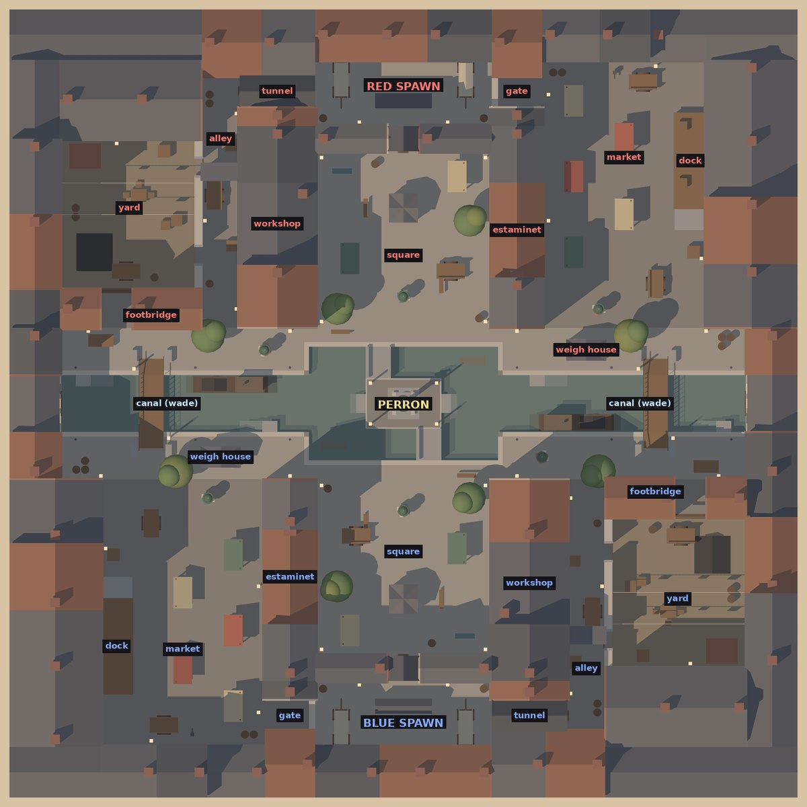
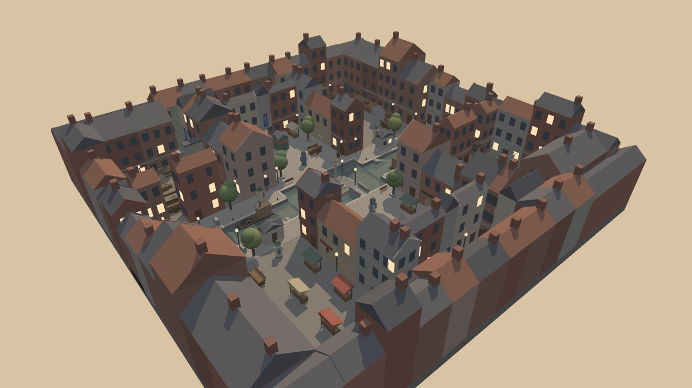
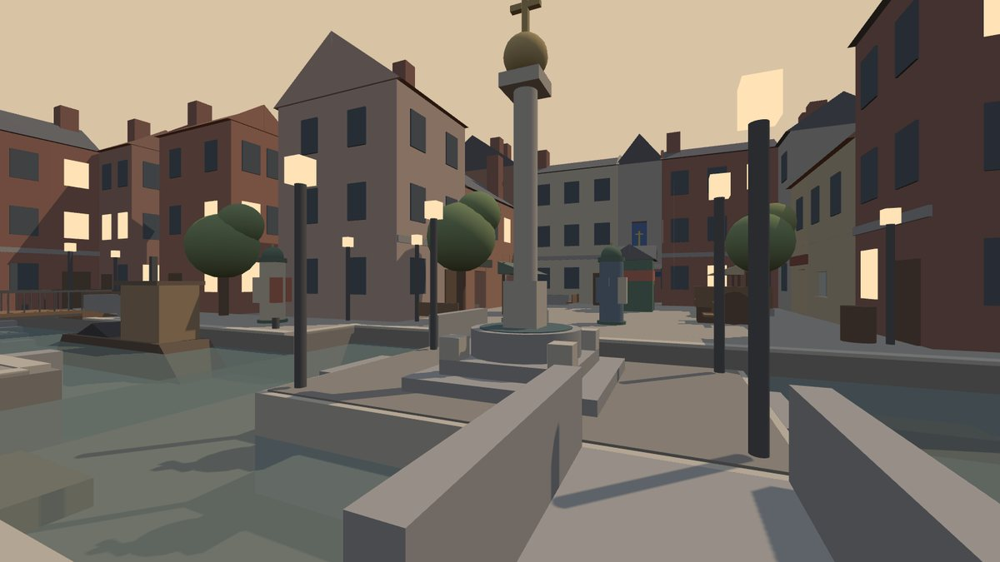
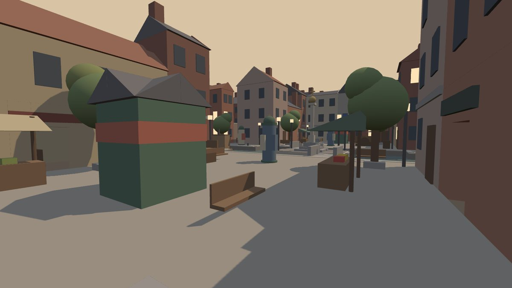
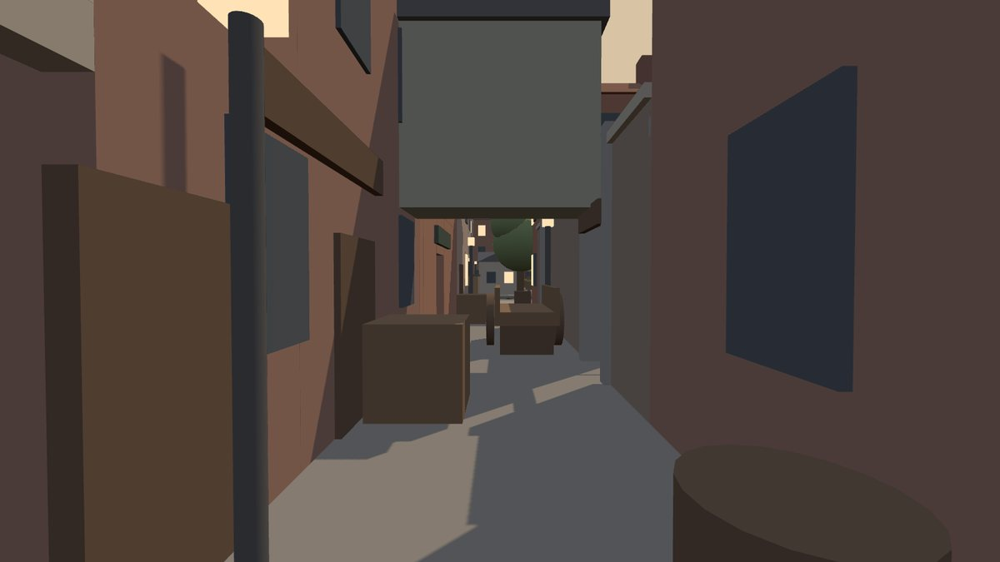
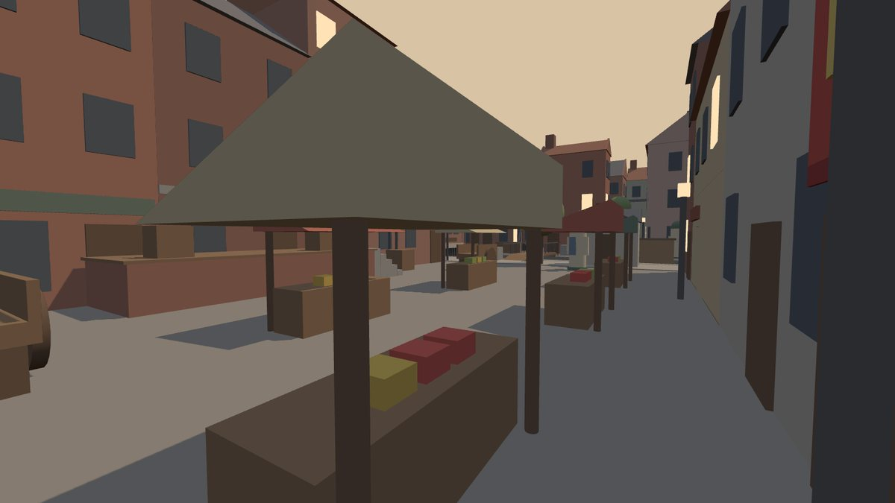
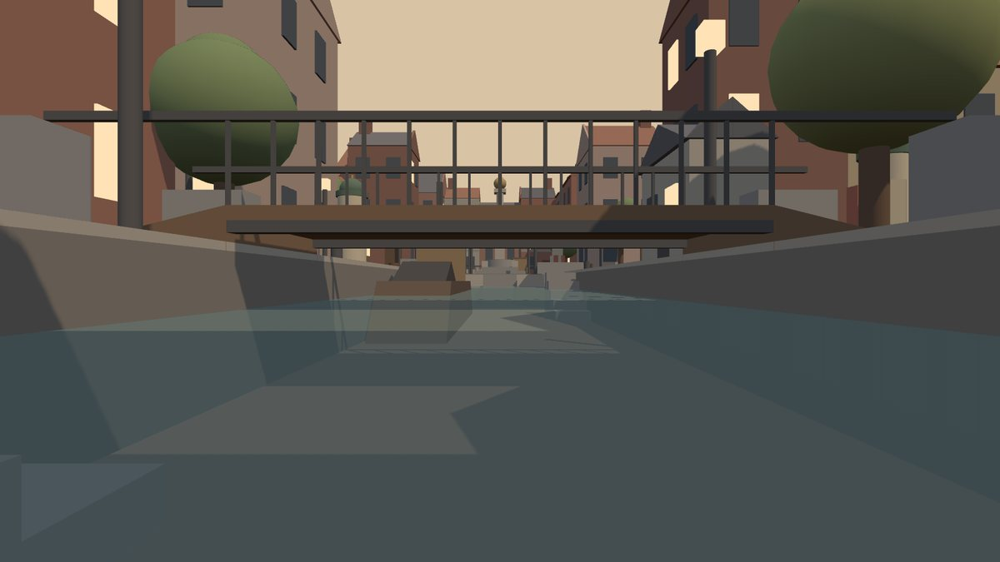

# Le Bief — a Liège duel map for Roblox

A 250 × 250 stud PvP duel map: a corner of Outremeuse, Liège, around 1870, the gunmaking city where
L. Dolne built the "Apache" knuckleduster revolver. Two spawn courtyards face each other across a
canal, with the Perron, Liège's emblem, on an island in the middle. It is a map only: no weapons and
no gameplay scripts. The map lights itself.



| | |
|---|---|
|  |  |
|  |  |
|  |  |

These pictures come from a stand-in renderer (`tools/preview`), not from Roblox Studio, so
materials, lighting and the text on signs will look different in Studio. Nothing has been opened in
Studio yet.

## Files

| File | Use |
|---|---|
| `build/LiegeDuel.rbxm` | The map as one model. Drag it into your place. |
| `build/LiegeDuel_Preview.rbxl` | A standalone place: the map, its lighting, a spawn on each side and two duellists for scale. Press Play to walk it. |
| `build/LiegeNPCs_R15.rbxm`, `build/LiegeNPCs_R6.rbxm` | 63 period NPC models, not placed on this map (see [NPCs](#npcs)). |
| `src/LiegeDuel.luau` | The map generator. |

## Adding it to your game

1. Drag `build/LiegeDuel.rbxm` into Studio and parent the `LiegeDuel` model to `Workspace`. It is
   centred on the origin and street level is `y = 0`; if you move it, move the whole model.
2. Lighting needs no setup: the map applies its own when the game runs (see
   [Lighting](#lighting)). To see it in Studio's edit mode too, paste into the command bar:

   ```lua
   require(workspace.LiegeDuel.Ambience.AmbienceCore).preview("Dusk")
   ```
3. Hook your duel system to the markers in `LiegeDuel.Markers` (all invisible, anchored, no
   collision, no raycasts, no touch):
   - `Spawns`: `Red_1`…`Red_4` and `Blue_1`…`Blue_4`, attributes `Team` and `Slot`, tag
     `LiegeDuelSpawn`. Slot 1 is the 1v1 spawn; slots 2–4 are for up to 4v4. Each part faces into
     the map, so `character:PivotTo(spawn.CFrame + Vector3.new(0, 3, 0))` stands a player on it.
   - `SpawnZones`: a `Red` and a `Blue` volume covering each spawn courtyard (tag
     `LiegeSpawnZone`), for spawn protection with `workspace:GetPartBoundsInBox`.
   - `PlayArea`: a volume around everything a player can reach, for out-of-bounds checks.

## The layout

North is `-Z` (Red), south is `+Z` (Blue). The map is point-symmetric: everything on Red's side
has an identical twin on Blue's side, turned 180° about the centre. Only the team banners differ:
red with a gold Perron on Red's side, blue on Blue's. Because the twin is turned rather than
mirrored, both teams have the same thing on the same hand: the narrow alley on their right, the
market on their left.

Each side, from the spawn outwards:

- **Spawn courtyard** with three exits: a covered tunnel to the alley, an open gate to the market,
  and a gateway to the square. Two covered wagons and the guardhouse screen the doorways.
- **The gunsmiths' alley** (right): 12 studs wide, carts and crates for cover. It opens onto a yard
  (the "Cour des Apaches": a shed, a coal heap and a gang table) through two gates.
- **The square** (centre): a newspaper kiosk, stalls, a cart, a horse trough and an advertising
  column.
- **The market** (left): the widest space. Stall rows make zigzag lanes, and a raised loading dock
  gives the only high ground on the map (4.8 studs, with crates on top).
- **Two pass-through buildings** connect the lanes: the gunsmith's workshop (alley ↔ square, with a
  lit forge) and the estaminet (square ↔ market, with a hearth). Doors are offset so you can't see
  straight through; each has one shoot-through window onto the square.
- **The quay**, with a weigh house, trees, crates and an advertising column, runs along the canal.

**The middle** is the canal, the open ground between the two sides. You can cross it four ways:

- a footbridge on each flank, high enough to wade underneath;
- the Perron island, reached by two bridges set off to opposite sides, so the centre is never a
  straight line;
- wading, using the stairs down from each quay. A moored barge with a cabin gives cover in the
  water.

## What was checked

`tools/check_duel.py` runs these checks on the built map:

- **Size:** the footprint is exactly 250 × 250.
- **Symmetry:** all 700 parts that block movement or shots have an identical twin on the other
  side.
- **Spawn safety:** none of the 8 spawn points can be seen or shot, at head or chest height, from
  anywhere outside its own courtyard and doorways.
- **Movement:** Red's spawn reaches Blue's on foot, and every spawn is on walkable ground.
- **Climbing:** jumping (7.2 studs high, about 8 across) reaches nothing higher than 7.5 studs
  except the crates on the market dock. Nothing gets you onto a roof or out of the map.
- **Sight lines:** from a typical spot you can see about 18% of the map. The longest open lines,
  about 210 studs, run diagonally across the canal. The lanes are broken up so the long
  alley-to-market lines across the map are blocked.

The checker works on a 1-stud grid with a simple jump model, so play it in Studio to be sure.

## Lighting

The `Ambience` folder inside the model holds three scripts that light the map by themselves, the
same ones as before. They have been run only in a mocked environment (`tools/test_ambience.luau`).

| Attribute on `Ambience` | Default | Meaning |
|---|---|---|
| `Mood` | `Dusk` | `Dusk`, `Night`, `Dawn` or `Overcast`. `Overcast` is the flattest light, if you want maximum visibility for competitive play. |
| `CycleMinutes` | `0` | `0` holds the mood; above zero runs a day/night cycle of that many minutes. |
| `ManageLighting` | `true` | `false` leaves `Lighting` completely alone. |
| `InteriorGrading` | `true` | Colour shift inside the workshops and estaminets. |
| `FireFlicker` | `true` | Flicker on the forges and hearths. |

The scripts reuse your `Atmosphere` and `Clouds` and add their own effects beside yours, and put
`Lighting` back as it was when the map is removed, so they suit a map rotation.

## Optimisation

- 2,090 parts: no unions, meshes or textures, everything anchored, `CanTouch` off.
- Windows, signs, doors, canopies and other decoration have collision, raycasts and shadows off, so
  shots and movement only meet the parts that matter.
- Stairs are visual steps over an invisible ramp named `StairRamp`. Don't delete the ramps: they
  are what players walk on.
- 60 `PointLight`s (street lamps, interiors, forges), all without shadows.
- `MapLimits` holds four invisible walls at the edge of the footprint.

## NPCs


The 63 NPC models made for the earlier 1000-stud city are kept as a standalone library: 3 bosses,
7 named characters, the Apache gang and 24 kinds of townsfolk, in R15 and R6. They are not placed
on the duel map. See [docs/NPC_SETUP.md](docs/NPC_SETUP.md).

The 1000-stud map, its NPC placements and their checks were removed from this repo. They are
still in its history at commit `741cf51`.

## Regenerating

The map is deterministic. To change it, edit `src/LiegeDuel.luau` and rebuild with
[Lune](https://lune-org.github.io/docs), then re-run the checks:

```sh
lune run build
python3 tools/check_duel.py        # fairness and exploit checks (about a minute)
lune run tools/test_ambience       # lighting scripts
lune run tools/test_npcs           # NPC rigs
```

The half-builder in `src/LiegeDuel.luau` authors Red's side; Blue's side is the same code run
again turned 180°, so any change stays symmetric. The four spawn slots are listed at the top of
that function: if you move cover in the courtyards, re-run the checker to confirm the spawns are
still hidden.

Without Lune, paste `src/LiegeDuel.luau` into a `ModuleScript` in `ServerStorage` named
`LiegeDuel` and run in the command bar:

```lua
require(game.ServerStorage.LiegeDuel)({ seed = 1871 }).Parent = workspace
```

That route does not embed the `Ambience` scripts; copy that folder across from the `.rbxm`.

`tools/inspect_place.luau` reports what a place or model file saved from Studio contains (maps,
characters, tools, lighting, scripts), for comparing your game with these assets:
`lune run tools/inspect_place Arena.rbxl report.md`. `tools/preview/render.js` draws the pictures
above (needs `three@0.160.0` and Playwright).
