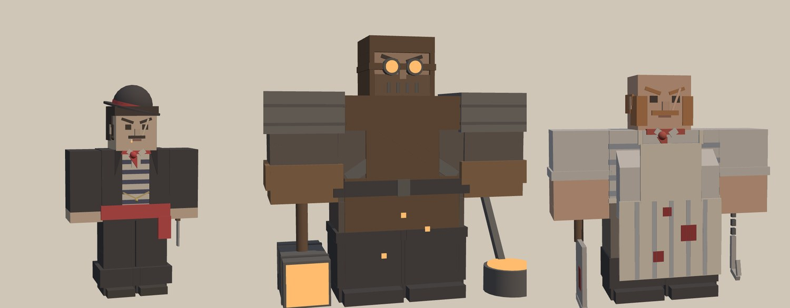
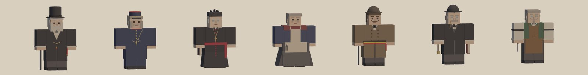
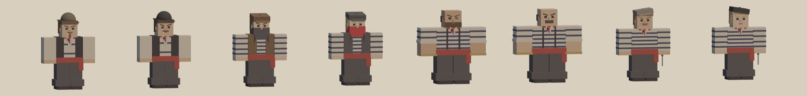
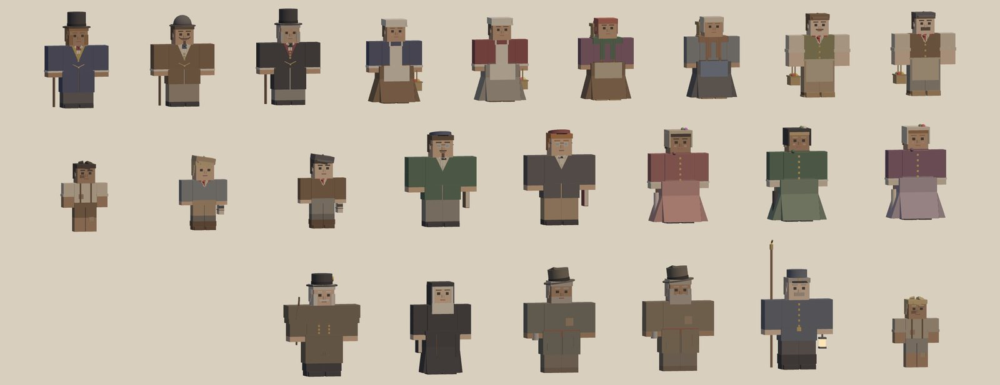
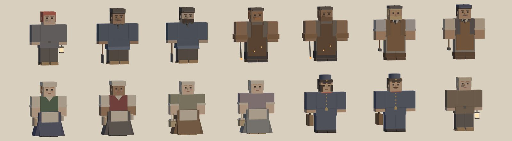
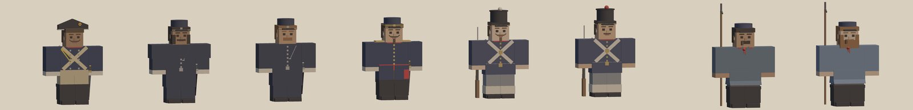

# NPCs: setup and handover notes

Everything here is models and data. No NPC moves, talks or fights yet; that is the scripting you
will do on PC. This file says what exists, what to decide, and what to do, in order.

The NPCs were made for the 1000-stud city map, which has since been replaced by the 250 × 250
duel map. They are now a standalone library: nothing is placed on the duel map. The `where` notes
below describe each character's setting in Liège, not a spot on the current map. The duel map's
preview place uses two of the Apaches as stand-ins for players, for scale.



These pictures come from a stand-in renderer, not Roblox Studio. Nothing in this folder has been
opened in Studio yet; see [Not verified](#not-verified-check-these-first).

## What there is

| File | What it is |
|---|---|
| `build/LiegeNPCs_R15.rbxm` | All 63 characters as R15 rigs, plus the `NPCCatalog` module. |
| `build/LiegeNPCs_R6.rbxm` | The same 63 characters as R6 rigs. |

**63 models from 38 character types**: 3 bosses, 7 named characters, 4 Apache gang types
(2 variants each), and 24 kinds of townsfolk, workers, soldiers and police, most in 2–3 colour or
face variants. Every model is 39–73 parts (R15) or 35–69 (R6).

### Bosses

| Id | Who | Setting |
|---|---|---|
| `BossButcher` | *Le Boucher de la Batte*: huge, cleaver and meat hook, blood-spattered apron | Halle aux Viandes, Quai de la Batte |
| `BossFounder` | *Le Maître Fondeur*: hooded foundry master, glowing goggles, red-hot sledgehammer and a ladle of molten iron | Fonderie Royale de Canons |
| `BossApacheKing` | *Le Roi des Apaches*: gang leader, tilted bowler, knife, right hand left free for your Apache revolver | Coal yard, Charbonnages de Longdoz |

### Named characters (quest givers and shopkeepers)



| Id | Who | Where |
|---|---|---|
| `Bourgmestre` | The mayor | Top of the Perron steps, Hôtel de Ville |
| `ChefDeGare` | Station master | Gare de Longdoz platform |
| `AbbeSaintPaul` | Priest | Altar of Saint-Paul |
| `Patronne` | Madame Gilson, tavern owner and informant | Behind the bar of the Estaminet |
| `Commissaire` | Police commissioner (the obvious quest giver) | Place du Marché |
| `ProofMaster` | Proof master of the Banc d'Épreuves | Proof-house entrance |
| `LouisDolne` | Louis Dolne, maker of the Apache revolver (gun shop) | Behind his counter, Atelier Dolne |

The names Hallet, Gilson and Lambrecht are invented. Louis Dolne was a real Liège gunsmith; his
lines are fiction.

### The Apaches (hostile)



`ApacheGunman` (bowler, waistcoat, right hand free for a revolver), `ApacheLookout` (scarf over
the face), `ApacheBrawler` (big, brass knuckles in both hands) and `ApacheKnife` (cap, knife).
They are placed in four gang spots: the back yards behind Hors-Château, the east-bank yards, the
proof-house alley and the coal-yard gate.

### Townsfolk, workers, soldiers and police





- **West bank**: market vendor, botteresse (Liège's basket porters, with the tall basket on the
  back), flower/fruit seller, gentleman, lady, student, newsboy, urchin, lamplighter, beggar,
  Ursuline nun, omnibus coachman.
- **East bank**: gunsmith journeyman, foundry worker, coal heaver, hiercheuse (female coal-cart
  pusher), railway porter, laundress, barmaid.
- **River**: bargeman.
- **Citadel and police**: line infantryman, garrison officer, city policeman, gendarme.

The full list with lines and suggested stats is in the `NPCCatalog` module.

## Decision 1: R15 or R6

Both files contain the same characters; only the skeleton differs. Pick the one whose animations
you will use:

- **R15** (15 body parts, elbows and knees): looks better walking, works with the default R15
  animations and most modern animation packs.
- **R6** (6 body parts): the classic rig many combat games use, simpler animations.

NPCs don't have to match the players' rig type; only the animations you play on them do.

## Install

1. Drag `LiegeNPCs_R15.rbxm` (or `_R6`) into Studio and move the `LiegeNPCs` folder into
   **ServerStorage**. These are templates; clone them at runtime.

The gallery models sit in rows at z ≈ 620–720, far outside the duel map, so dropping the folder into
Workspace by mistake doesn't put anyone in the streets.

## What is inside each model

```
Gentleman_1  (Model, PrimaryPart = HumanoidRootPart)
├─ HumanoidRootPart, LowerTorso, UpperTorso, Head, LeftUpperArm … RightFoot   (R15 names)
│     or HumanoidRootPart, Torso, Head, Left Arm, Right Arm, Left Leg, Right Leg (R6 names)
├─ Outfit  (Model)  hats, hair, beards, coats, aprons… welded to the body
├─ Props   (Model)  what the hands hold (cane, rifle, basket, cleaver…) — delete to empty the hands
└─ Humanoid  └─ Animator
```

- **Joints**: standard `Motor6D` names and frames (`Root`, `Waist`, `Neck`, `LeftShoulder`…
  for R15; `RootJoint`, `Neck`, `Left Shoulder`… for R6), so stock animations drive them.
- **Attachments**: the standard accessory ones (`HatAttachment`, `FaceFrontAttachment`,
  `RightGripAttachment`…), so `Humanoid:AddAccessory()` and Tools work. Extras:
  `OverheadAttachment` above the head (for name tags or health bars) and `PromptAttachment` in front
  of the chest.
- **Physics**: clothing and props are `Massless` with `CanCollide`, `CanQuery` and `CanTouch` off.
  Raycasts and hitboxes only ever hit the body parts underneath.
- **Humanoid**: `DisplayDistanceType = None` and health bar off (use your own UI),
  `BreakJointsOnDeath = false` (ready for a ragdoll), `AutomaticScalingEnabled = false` (keeps the
  proportions). `MaxHealth` and `WalkSpeed` are filled in with suggestions.
- **Pivot at the feet**: `model:PivotTo(cframe)` stands the character on `cframe`, facing its
  `LookVector` (the pivot offset is on the `HumanoidRootPart`).
- **Streaming**: `ModelStreamingMode = Atomic`, so a character never streams in with missing limbs.
- **Talk prompts**: the 7 named characters carry a `ProximityPrompt` called `TalkPrompt`.
  It shows "Talk" but does nothing until you connect `Triggered`.

**Attributes** on every model: `NPCId`, `Variant`, `DisplayName`, `Title`, `Category`
(`Boss` / `Named` / `Hostile` / `Ambient`), `District`, `Behaviour`, `Hostile`, `Rig`, `Scale`,
`Height`; `HoldsApache` and `Arena` where they apply.
**Tags**: `LiegeNPC`, plus `LiegeBoss`, `LiegeNamed`, `LiegeHostile` or `LiegeAmbient`.

**`NPCCatalog`** (ModuleScript in the folder): `require` it for each character's display name,
where it belongs, suggested behaviour, health, walk speed, model names, dialogue `Lines` and, for
bosses, `Moves` (attack ideas) and `Arena`.

A minimal spawner, to show how the pieces fit (not shipped as a script):

```lua
local templates = game.ServerStorage.LiegeNPCs

local function template(npcType)
	local list = {}
	for _, m in templates:GetDescendants() do
		if m:IsA("Model") and m:GetAttribute("NPCId") == npcType then table.insert(list, m) end
	end
	return list[math.random(#list)]
end

local function spawnAt(npcType, cframe)
	local npc = template(npcType):Clone()
	npc:PivotTo(cframe)  -- every character's pivot is at its feet
	npc.Parent = workspace
	npc.PrimaryPart:SetNetworkOwner(nil)
	return npc
end
```

## To do on PC, in order

1. **Animations.** I could not make these here: animations have to be created and uploaded in
   Studio. Quickest start: press Play, copy the `Animate` script from your own character, stop,
   paste it into an NPC as a server `Script`, and it walks and idles with the default animations
   (use an R15 character for R15 NPCs, R6 for R6). Then make a few idles per `Behaviour`:
   guards at attention, vendors arms-crossed, workers hammering or shovelling, the priest with the
   book raised, and an attack set per boss (see `Moves` in the catalogue).
2. **Behaviour scripts.** Give each character the behaviour named in its `Behaviour` attribute:
   a random walk for `Wander`, a route for `Patrol`, standing for the rest. For
   `PathfindingService` use `AgentRadius = 2`, `AgentHeight = 6` for townsfolk and scale both by
   the model's `Scale` attribute for bosses (up to 1.55).
3. **Anchor whoever doesn't move.** Shopkeepers, guards and vendors can keep
   `HumanoidRootPart.Anchored = true`: they still play idle animations and cost far less. Unanchor
   only NPCs that walk, and `SetNetworkOwner(nil)` on those.
4. **Collision group.** Put all NPCs in a group that does not collide with itself, so crowds and
   patrols don't shove each other.
5. **Bosses.** They need an arena (the duel map has none) and the moves listed in the catalogue.
   The Foundry Master's sledge already glows and burns (`PointLight` and `Fire` on its head). The
   catalogue suggests the Apache King calls his gang in at 66% and 33% health.
6. **The Apache revolver.** Models with `HoldsApache = true` (the King and the gunmen) have an empty
   right hand. Either give them your revolver Tool with `Humanoid:EquipTool()`, or weld the model to
   `RightGripAttachment` (in `RightHand` on R15, `Right Arm` on R6).
7. **Dialogue.** Connect each named character's `TalkPrompt.Triggered` to your dialogue UI. Ambient
   NPCs can say their catalogue `Lines` as chat bubbles (`TextChatService:DisplayBubble`) when a
   player walks by.
8. **Name tags and health bars.** Parent a `BillboardGui` to `Head.OverheadAttachment`, for
   bosses at least.
9. **Death.** `BreakJointsOnDeath` is off: swap the `Motor6D`s for `BallSocketConstraint`s on death
   for a ragdoll, or play a death animation.
10. **Performance.** Each character is 35–73 parts and one Humanoid; around 100 at once is fine on
    PC. On phones, keep crowds small or spawn them only near players.

## Not verified (check these first)

- **Nothing has been opened in Studio.** The models were built and checked by script (15,365
  checks: joints line up with the parts, every part is jointed to the root, feet on the floor,
  outfit flags, catalogue compiles), but no animation has been
  played on them.
- **R15 joint positions** follow Roblox's naming and orientation but not its exact proportions.
  Stock animations should play correctly; elbows and shoulders may bend a little higher or lower
  than on a default avatar.
- **R6 on the scaled characters** (children at 0.7×, bosses up to 1.55×): `HipHeight` is set from
  Roblox's documented formula, which puts the feet on the floor. If one floats or sinks in Play
  mode, adjust its `Humanoid.HipHeight`.
- **Looks**: colours and materials (`Fabric`, `Leather`, `Neon` goggles) will look different from
  these renders, especially under the map's Dusk and Night moods.
- **Lights on characters**: the lamplighter's and hiercheuse's lanterns and the Foundry Master's
  sledge carry `PointLight`s. If they clash with the night lighting, turn them down.

## Choices I made for you (change freely)

- **Faces are built from parts, not decals**, to match the map's style and avoid asset ids. To give
  someone a different expression, recolour or move the `Eye`, `Brow` and `Mouth` parts in `Outfit`.
- **The bosses** are a brute (Butcher), a tank (Foundry Master) and a duellist (Apache King), so
  each fight plays differently. A rogue Citadel commander would be the natural fourth: give the
  `Officer` a bigger `Scale` and an arena on the parade ground.
- **The hostiles are the Apache gang**, since the revolver is their weapon.
- **Uniforms** are approximations of 1870s Belgian line infantry, gendarmerie, city police and
  railway dress, not reproductions.

## Editing or regenerating

- **In Studio**: recolour or delete parts freely. If you move an outfit part, re-weld it (its weld is
  called `Attach`) or it will snap back when the game runs.
- **From the source**: the characters are defined in `src/LiegeNPCs.luau` (the `ROSTER` section,
  one `def({...})` per character, using wardrobe functions such as `K.tophat`, `K.apron`,
  `K.cane`). Rebuild and re-test with:

  ```sh
  lune run build
  lune run tools/test_npcs
  ```
